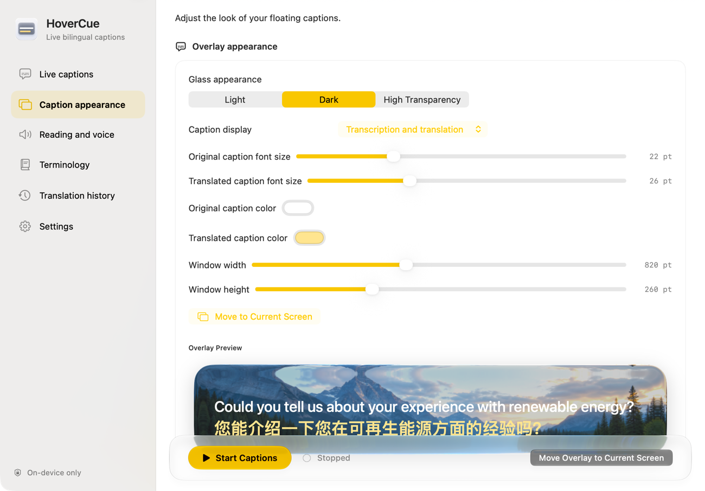
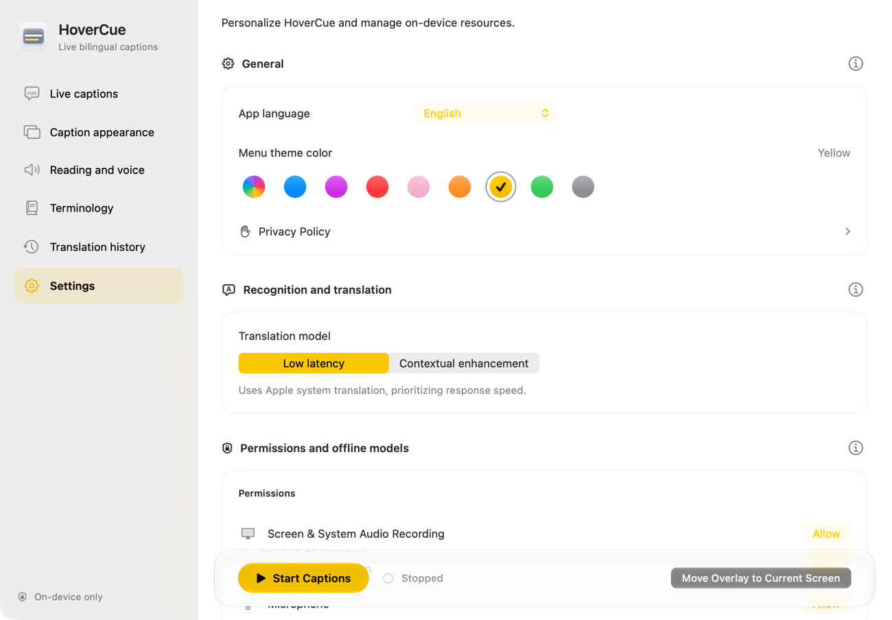
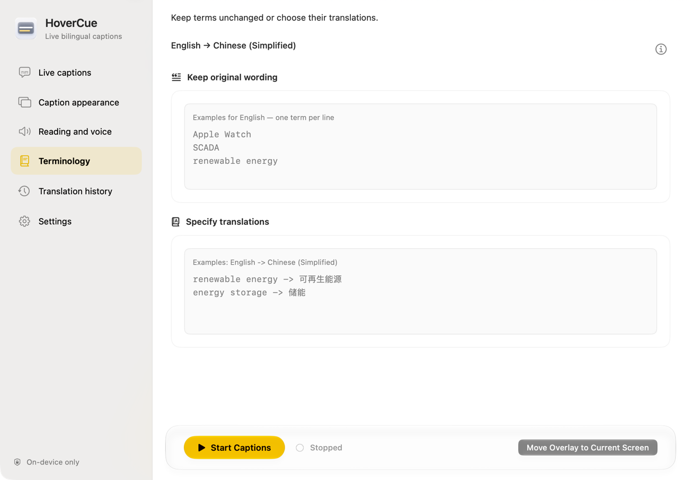
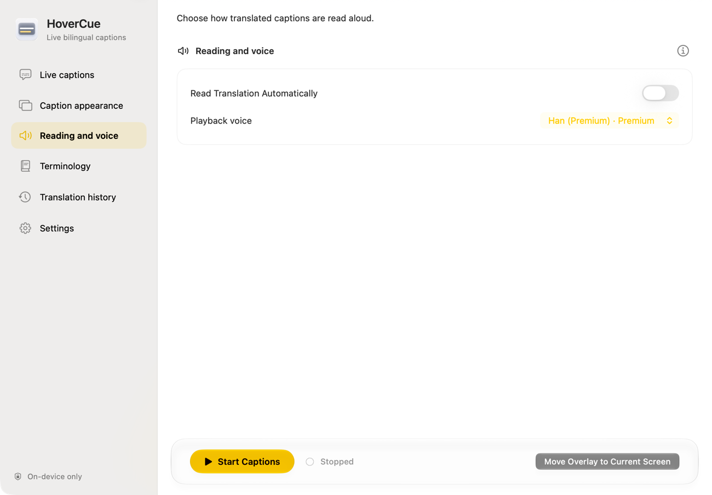
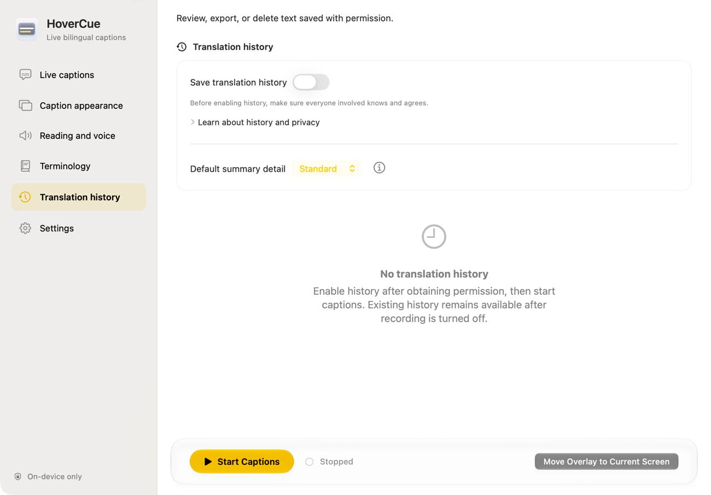
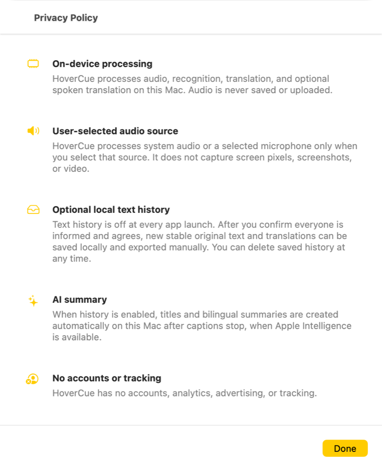

<p align="center">
  
</p>

<h1 align="center">HoverCue</h1>

<p align="center"><strong>Live bilingual captions for Mac</strong></p>

<p align="center">Follow meetings, courses and videos with the original speech and its translation in a floating caption window. Speech recognition and translation run on your Mac.</p>

<p align="center">
  <strong><a href="https://github.com/WenyuGao1/HoverCue/releases/download/v1.0.2/HoverCue-v1.0.2-macOS-arm64.dmg">Download for Mac</a></strong>
  · <a href="https://github.com/WenyuGao1/HoverCue/releases/latest">Release notes</a>
  · <a href="README.zh-CN.md">简体中文</a>
</p>

**Before installing.** HoverCue needs an Apple silicon Mac running macOS 26 or later. macOS may block the first launch because this build is locally signed and has not been notarized by Apple. [First launch and permissions](#download-and-use)


## See HoverCue in action

Choose the microphone, one Mac app, or all system audio. Set the spoken and translated languages, then start captions. HoverCue offers English, Chinese (Simplified and Traditional), German, Spanish, French, Italian, Japanese, Korean and Portuguese. Exact language combinations depend on macOS and the language resources installed.

<table>
  <tr>
    <td width="50%" valign="top">
      <strong>Floating caption controls</strong><br>
      <a href="docs/images/en/appearance-v1.0.2.png"></a><br>
      Adjust text size, colors and glass appearance. Revisit recent caption pairs in the floating window.
    </td>
    <td width="50%" valign="top">
      <strong>Two translation modes</strong><br>
      <a href="docs/images/en/translation.png"></a><br>
      Use low latency to keep up with speech or let contextual enhancement consider recent sentences on supported Macs.
    </td>
  </tr>
  <tr>
    <td width="50%" valign="top">
      <strong>Custom terminology</strong><br>
      <a href="docs/images/en/terminology.png"></a><br>
      Keep names, acronyms and technical terms as written, or supply a preferred translation for each language pair.
    </td>
    <td width="50%" valign="top">
      <strong>Spoken translations</strong><br>
      <a href="docs/images/en/voice.png"></a><br>
      Read completed translations aloud. Choose an installed macOS voice for the target language.
    </td>
  </tr>
  <tr>
    <td width="50%" valign="top">
      <strong>Optional local history</strong><br>
      <a href="docs/images/en/history.png"></a><br>
      Save and export bilingual text after everyone agrees. Supported Macs can generate summaries on device.
    </td>
    <td width="50%" valign="top">
      <strong>On-device processing</strong><br>
      <a href="docs/images/en/privacy.png"></a><br>
      Speech recognition and translation run on your Mac. Audio is never saved or uploaded.
    </td>
  </tr>
</table>

*Screenshots taken on macOS. The main window and caption appearance use the v1.0.2 landscape. The captions are built in, and the history page shows its initial empty state.*

## Download and use

1. **Install and open HoverCue.** Download the DMG, drag HoverCue to **Applications**, and try opening it there. [Official download](https://github.com/WenyuGao1/HoverCue/releases/latest)
2. **If macOS blocks the initial launch.** Confirm you downloaded the DMG from the official release above. After attempting to open the app, go to **System Settings → Privacy & Security**, scroll down, select **Open Anyway**, and confirm. [Apple’s instructions](https://support.apple.com/en-us/102445)
3. **Grant access for the audio you want to use.** Choose your audio source and languages in **Live captions**. Then go to **Settings → Permissions and offline models** in HoverCue, click **Allow** next to the permissions you need, and follow the macOS prompt.

   - **Speech Recognition** is required for all audio sources. If you previously declined it, enable HoverCue under **System Settings → Privacy & Security → Speech Recognition**.
   - **Screen & System Audio Recording** is required for **All System Audio** or audio from a single app. In macOS, enable HoverCue under **System Settings → Privacy & Security → Screen & System Audio Recording**. HoverCue receives audio only and captures no screen images. If macOS asks, quit and reopen HoverCue.
   - **Microphone** is needed only when using a microphone as the source. Grant it in HoverCue’s settings or when macOS prompts you after you select a microphone and start captions. If you previously declined it, enable HoverCue under **System Settings → Privacy & Security → Microphone**.

4. **Prepare the languages and start captions.** If the speech or translation model is missing, choose **Download required models** in **Settings → Permissions and offline models**. macOS may need internet access to download the selected language resources. Once the app shows **Ready for offline captions**, return to **Live captions** and click **Start Captions**. The audio and translation are processed on your Mac.

Press **⌥⌘C** to start or stop captions and **⌥⌘O** to show or hide the floating window. When you select a browser as the source, HoverCue receives audio from all of its tabs.

Low-latency translation and terminology controls require **macOS 26.4 or later**. Contextual enhancement also requires Apple Intelligence and a supported language pair. HoverCue falls back to system translation when contextual enhancement is unavailable.

> Official HoverCue releases are available free of charge from this repository. Third-party distributors must not present their releases as official or imply approval or endorsement by the HoverCue project.

## Build from source

The project uses Apple frameworks and has no external packages. The verified build toolchain is **Xcode 27.2**.

```sh
git clone https://github.com/WenyuGao1/HoverCue.git
cd HoverCue
open LocalDualCaption.xcodeproj
```

Select **LocalDualCaption** and **My Mac** in Xcode, then choose **Product → Run**. A local command-line build uses the same scheme.

```sh
xcodebuild -project LocalDualCaption.xcodeproj -scheme LocalDualCaption \
  -configuration Debug -destination 'platform=macOS,arch=arm64' \
  -derivedDataPath DerivedData build
open DerivedData/Build/Products/Debug/HoverCue.app
```

This uses local development signing. If another copy of HoverCue is installed, make sure you open the build you just compiled.

```sh
./Scripts/verify_release.sh
```

The verification script checks localized resources, runs the macOS tests, analyzes and builds the Release configuration, and verifies its signature and entitlements. The system translation integration test may need Apple language resources installed.

[Architecture](docs/architecture.md) · [Privacy](docs/privacy.md) · [Verification](docs/testing.md) · [Dependency and asset notes](THIRD_PARTY_NOTICES.md)

## Feedback

Report issues with your macOS and HoverCue versions, language pair, audio source type and steps that use sample material. Keep real audio, captions, translations, exported histories and meeting screenshots private. [GitHub Issues](https://github.com/WenyuGao1/HoverCue/issues)

## License

Copyright © 2026 Wenyu Gao. The HoverCue source and original project assets are licensed under the [GNU General Public License, version 3 only](LICENSE), SPDX `GPL-3.0-only`. You may study, modify and use the software commercially. Distributors of a GPL-covered modified version must make the corresponding source available to recipients as required by the license.

The earlier `v1.0.0` release retains the MIT terms under which it was published. Apple frameworks and OS-provided models are supplied separately under their applicable terms. [Dependency and asset notes](THIRD_PARTY_NOTICES.md)
