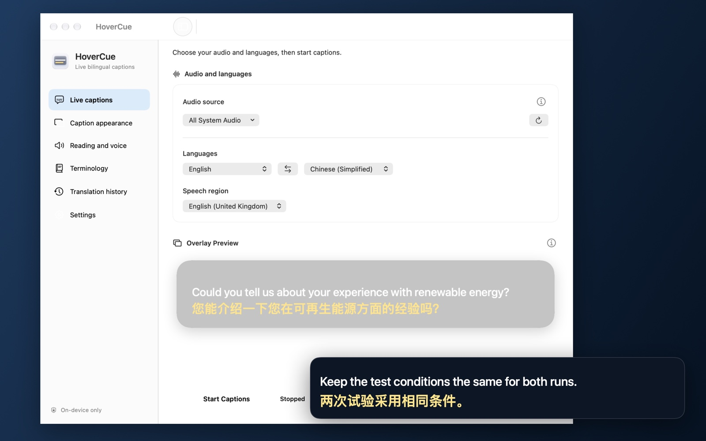

# HoverCue

HoverCue is a native macOS app that turns audio from a selected app, all system audio, or a microphone into floating bilingual captions. Speech recognition and translation run on your Mac using Apple frameworks.

[简体中文](README.zh-CN.md) · [Privacy](docs/privacy.md) · [Architecture](docs/architecture.md) · [Verification](docs/testing.md) · [Dependency review](THIRD_PARTY_NOTICES.md)

> Official HoverCue releases are available free of charge from this repository. Third-party distributors must not present their releases as official or imply approval or endorsement by the HoverCue project. [Official downloads](https://github.com/WenyuGao1/HoverCue/releases/latest)



## What it does

- Shows the original speech and its translation in a floating window.
- Offers low-latency translation and optional contextual enhancement on compatible Macs.
- Preserves names and specialist terms using your own terminology rules.
- Can read stable translations aloud using macOS voices.
- Can save and export text history after you enable it and confirm that everyone involved knows and agrees. Supported Macs can generate bilingual summaries locally.

## Requirements

- A Mac with Apple silicon and macOS 26 or later.
- macOS 26.4 or later for the low-latency strategy and terminology controls. Contextual enhancement also requires Apple Intelligence and a supported language pair.
- Xcode 27.2 is the verified build toolchain. The code uses newer SDK APIs with availability checks at runtime. The project uses only Apple frameworks and has no external packages.

## Build and run

```sh
git clone https://github.com/WenyuGao1/HoverCue.git
cd HoverCue
open LocalDualCaption.xcodeproj
```

In Xcode, select the **LocalDualCaption** scheme and **My Mac**, then choose **Product → Run**. The product is `HoverCue.app`. For a local command-line build:

```sh
xcodebuild -project LocalDualCaption.xcodeproj -scheme LocalDualCaption \
  -configuration Debug -destination 'platform=macOS,arch=arm64' \
  -derivedDataPath DerivedData build
open DerivedData/Build/Products/Debug/HoverCue.app
```

This uses local development signing. For first-run testing, make sure you're opening the build you just compiled if another copy of HoverCue is installed.

In HoverCue, choose the spoken and translated languages and prepare any missing language resources. macOS may need internet access to download them the first time. Select an audio source, grant the permissions macOS requests for that source, and start captions. Use **⌥⌘C** to start or stop captions and **⌥⌘O** to show or hide the floating window.

System audio permissions are managed in **System Settings → Privacy & Security → Screen & System Audio Recording**. System audio selection works at the app level, so selecting a browser includes audio from that browser's other tabs. Microphone permission is requested only when you explicitly choose a microphone source or request access.

## Run the checks

From the repository root:

```sh
./Scripts/verify_release.sh
```

This checks the localized resources, runs the macOS unit tests, analyzes and builds the Release configuration, and verifies the local app signature and entitlements. An integration test may need an Apple-managed translation resource installed on the test Mac. To test live audio and first-run permissions, run the app interactively.

## Architecture

ScreenCaptureKit supplies selected app or system audio. Apple audio input APIs handle the microphone. A bounded caption pipeline feeds on-device Speech recognition, then Apple Translation or optional Foundation Models enhancement. The floating window displays the results. Spoken translation and opt-in SQLite text history run on separate paths. [Architecture and code map](docs/architecture.md)

## Feedback

Use GitHub Issues to report bugs. Include the macOS version, HoverCue version, language pair, audio source type, and steps that use public or synthetic material. Keep real audio, captions, translations, exported histories, and meeting screenshots private.

## License

Copyright © 2026 Wenyu Gao. The HoverCue source and original project assets in this version are licensed under the [GNU General Public License, version 3 only](LICENSE), SPDX `GPL-3.0-only`. You may study, modify, and use the software commercially. If you distribute a modified version covered by this license, you must comply with GPLv3, including making the corresponding source available to recipients as required by the license. The earlier `v1.0.0` release was published under MIT and remains subject to the license that accompanied it.

Apple frameworks and OS-provided models are supplied separately by Apple under their applicable terms. See [dependency and asset notes](THIRD_PARTY_NOTICES.md).
