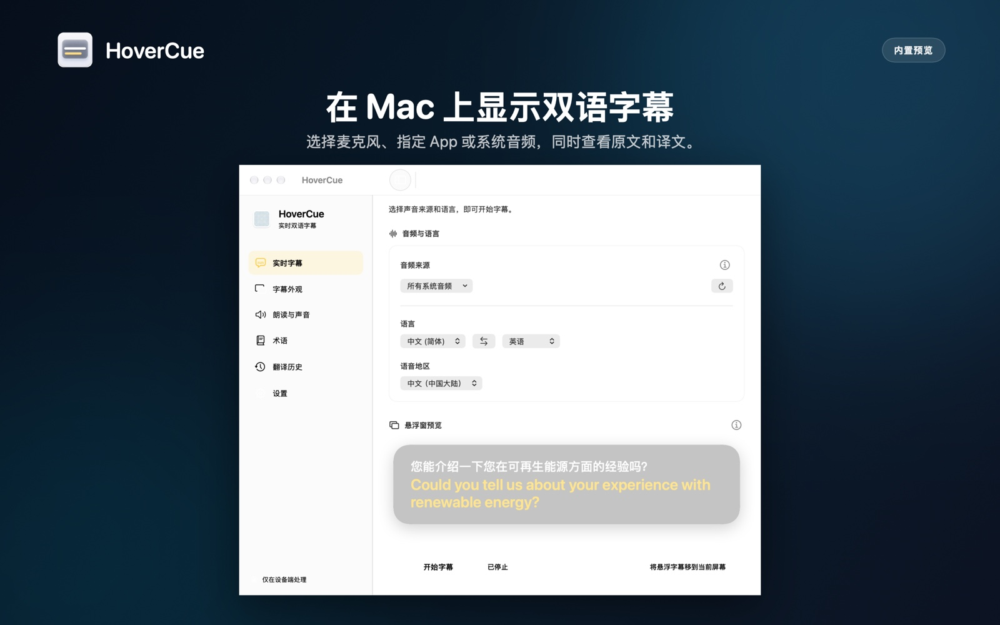

# HoverCue

HoverCue 是一款原生 macOS 实时双语字幕工具。它可处理指定应用、全部系统音频或麦克风输入，把原文和译文显示在悬浮窗口里。语音识别和翻译通过 Apple 框架在本机运行。

[English](README.md) · [隐私说明](docs/privacy.md) · [技术架构](docs/architecture.md) · [验证记录](docs/testing.md) · [依赖与授权](THIRD_PARTY_NOTICES.md)

> HoverCue 官方版在本仓库免费提供。第三方发布者不得冒充官方发布，也不得暗示其版本获得 HoverCue 项目的认可或背书。 [官方下载](https://github.com/WenyuGao1/HoverCue/releases/latest)



## 功能

- 在悬浮窗口同时显示原文与译文。
- 支持低延迟翻译，并可在兼容的 Mac 上使用上下文增强。
- 通过自定义术语规则保留原词或指定译法。
- 可用 macOS 系统音色朗读稳定译文。
- 手动开启并确认相关参与者已知晓且同意后，可在本机保存和导出文字历史。兼容机型还可在本机生成双语总结。

## 系统要求

- 搭载 Apple 芯片、运行 macOS 26 或更新版本的 Mac。
- 低延迟翻译策略和术语控制需要 macOS 26.4 或更新版本。上下文增强还需要可用的 Apple 智能和受支持的语言组合。
- 已验证的构建工具链为 Xcode 27.2。新版 SDK 接口在运行时有系统版本检查。工程只使用 Apple 框架，无外部依赖包。

## 构建和使用

```sh
git clone https://github.com/WenyuGao1/HoverCue.git
cd HoverCue
open LocalDualCaption.xcodeproj
```

在 Xcode 选择 **LocalDualCaption** 和 **My Mac**，然后选择 **Product → Run**。也可以从终端构建并打开应用：

```sh
xcodebuild -project LocalDualCaption.xcodeproj -scheme LocalDualCaption \
  -configuration Debug -destination 'platform=macOS,arch=arm64' \
  -derivedDataPath DerivedData build
open DerivedData/Build/Products/Debug/HoverCue.app
```

本地构建使用开发签名。如果电脑上已装有另一份 HoverCue，首次试运行时请确认打开的是刚构建的版本。

在 HoverCue 中选择原文和译文语言，按提示准备缺少的语言资源。首次下载资源时 macOS 可能需要联网。选择音源并授予系统要求的权限后，即可开始字幕。按 **⌥⌘C** 开始或停止字幕，按 **⌥⌘O** 显示或隐藏悬浮窗。

系统音频权限在 **系统设置 → 隐私与安全性 → 屏幕与系统音频录制** 管理。音源筛选以应用为单位，选择浏览器会处理该浏览器其他标签页的声音。只有明确选择麦克风音源或主动申请授权后，应用才请求麦克风权限。

## 验证

在仓库根目录运行：

```sh
./Scripts/verify_release.sh
```

脚本检查本地化资源，运行 macOS 单元测试，分析并构建 Release 版本，再验证生成应用的本地签名和权限。系统翻译集成测试可能需要提前安装 Apple 提供的语言资源。真实音频和首次授权可通过手动运行应用来验证。

## 技术架构

ScreenCaptureKit 采集所选应用或系统音频，麦克风走 Apple 的音频输入接口。有界字幕流水线将音频送入本机语音识别，再调用 Apple Translation 或可选的 Foundation Models 上下文增强。悬浮窗显示双语结果，译文朗读和用户主动开启的 SQLite 文字历史各走独立流程。 [架构与源码位置](docs/architecture.md)

## 反馈

欢迎在 GitHub Issues 报告问题。请提供 macOS 和 HoverCue 版本、语言组合、音源类型，以及使用公开或虚构素材的复现步骤。请将真实音频、字幕、译文、导出记录和会议截图留在本机。

## 许可证

版权 © 2026 Wenyu Gao。本版本的 HoverCue 源码和原创项目素材采用 [GNU 通用公共许可证第三版](LICENSE)，SPDX 标识为 `GPL-3.0-only`。允许学习、修改、商用和分发。分发受此许可证约束的修改版时，须遵守 GPLv3，包括按许可证要求向接收者提供对应源码。此前的 `v1.0.0` 已以 MIT 发布，旧版沿用当时附带的许可。

Apple 系统框架及系统模型由 Apple 单独提供，适用各自条款。 [依赖与素材说明](THIRD_PARTY_NOTICES.md)
