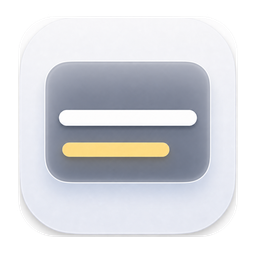
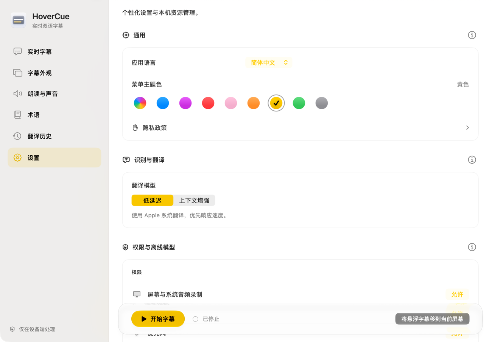
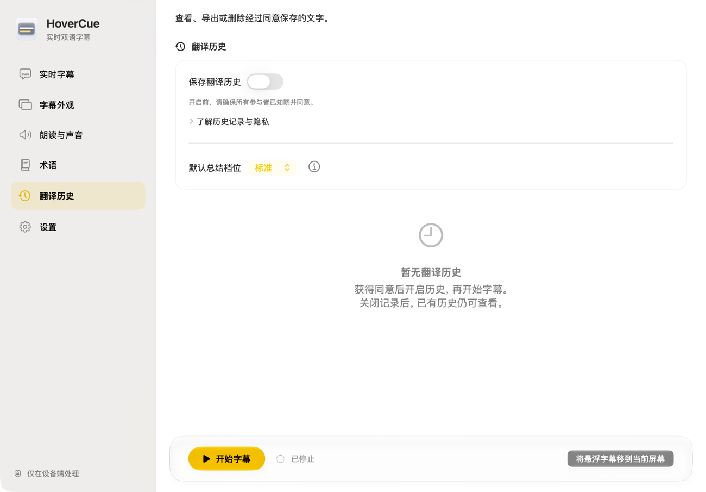
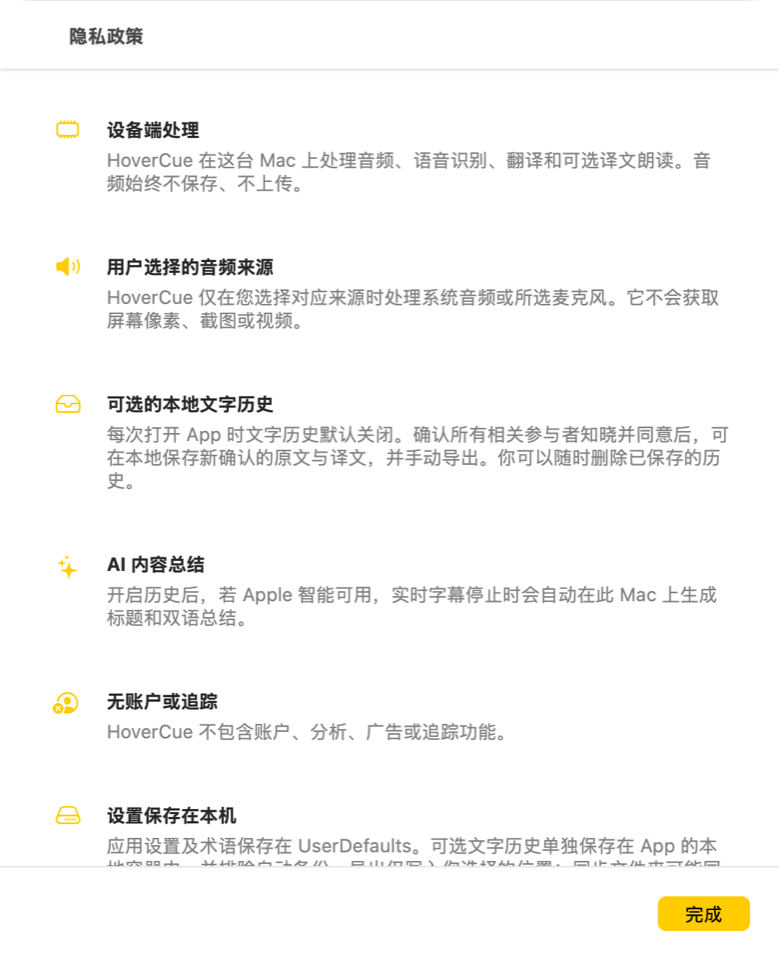

<p align="center">
  
</p>

<h1 align="center">HoverCue</h1>

<p align="center"><strong>Mac 上的实时双语悬浮字幕</strong></p>

<p align="center">开会、听课或看视频时，在屏幕上同时看原文和译文。语音识别和翻译在 Mac 上完成。</p>

<p align="center">
  <strong><a href="https://github.com/WenyuGao1/HoverCue/releases/download/v1.0.1/HoverCue-v1.0.1-macOS-arm64.dmg">下载 Mac 安装包</a></strong>
  · <a href="https://github.com/WenyuGao1/HoverCue/releases/latest">发布说明</a>
  · <a href="README.md">English</a>
</p>


## 功能与界面

可以选麦克风、指定的 Mac 应用或全部系统音频。设置原文和译文语言后即可开启字幕。支持英语、简体及繁体中文、德语、西班牙语、法语、意大利语、日语、韩语和葡萄牙语。具体可用的语言组合取决于 macOS 版本及语言资源。

<table>
  <tr>
    <td width="50%" valign="top">
      <strong>悬浮字幕外观</strong><br>
      <a href="docs/images/zh-CN/appearance.png"></a><br>
      调节字体大小、颜色和玻璃外观，也可以在悬浮窗里回看最近的双语字幕。
    </td>
    <td width="50%" valign="top">
      <strong>两种翻译模式</strong><br>
      <a href="docs/images/zh-CN/translation.png"></a><br>
      低延迟模式适合跟上讲话。在支持 Apple 智能的 Mac 上，上下文增强可以参考前面几句。
    </td>
  </tr>
  <tr>
    <td width="50%" valign="top">
      <strong>自定义术语</strong><br>
      <a href="docs/images/zh-CN/terminology.png"></a><br>
      保留人名、缩写和专业词，也可以按语言方向指定固定译法。
    </td>
    <td width="50%" valign="top">
      <strong>译文朗读</strong><br>
      <a href="docs/images/zh-CN/voice.png"></a><br>
      为译文语言选择已安装的 macOS 系统音色，自动朗读完成的译文。
    </td>
  </tr>
  <tr>
    <td width="50%" valign="top">
      <strong>可选的本地历史</strong><br>
      <a href="docs/images/zh-CN/history.png"></a><br>
      征得参与者同意后可保存、回看和导出双语文字，兼容的 Mac 还能在本地生成双语总结。
    </td>
    <td width="50%" valign="top">
      <strong>全程在本机处理</strong><br>
      <a href="docs/images/zh-CN/privacy.png"></a><br>
      语音识别和翻译都在 Mac 上进行，音频不保存、不上传。文字历史每次启动默认关闭。
    </td>
  </tr>
</table>

*以上为 HoverCue v1.0.1 在 macOS 上的实拍。字幕来自应用内置预览，历史页显示初次使用时的空白状态。*

## 下载和使用

1. 在搭载 **Apple 芯片**、运行 **macOS 26 或更新版本**的 Mac 上下载[安装包](https://github.com/WenyuGao1/HoverCue/releases/latest)。
2. 打开 DMG，把 HoverCue 拖进“应用程序”，再打开。首次打开若被系统拦截，请看[发布页里的打开方法](https://github.com/WenyuGao1/HoverCue/releases/latest)。
3. 选择音源和双语方向，按系统提示授权，并准备所需的语言资源。macOS 首次下载资源时可能需要联网。

按 **⌥⌘C** 开始或停止字幕，按 **⌥⌘O** 显示或隐藏悬浮窗。系统音频权限在 **系统设置 → 隐私与安全性 → 屏幕与系统音频录制**。选择浏览器作为音源时，会处理该浏览器多个标签页的音频。只有明确选择麦克风音源或主动申请授权后，应用才会请求麦克风权限。

低延迟翻译和术语控制需要 **macOS 26.4 或更新版本**。上下文增强还需要 Apple 智能和受支持的语言组合。上下文增强不可用时，应用会回到系统翻译。

> HoverCue 官方版在本仓库免费提供。第三方发布者不得冒充官方发布，也不得暗示其版本获得 HoverCue 项目的认可或背书。

## 从源码构建

工程只使用 Apple 框架，无外部依赖包。已验证的构建工具链为 **Xcode 27.2**。

```sh
git clone https://github.com/WenyuGao1/HoverCue.git
cd HoverCue
open LocalDualCaption.xcodeproj
```

在 Xcode 选择 **LocalDualCaption** 和 **My Mac**，然后选择 **Product → Run**。也可以从终端构建并打开应用。

```sh
xcodebuild -project LocalDualCaption.xcodeproj -scheme LocalDualCaption \
  -configuration Debug -destination 'platform=macOS,arch=arm64' \
  -derivedDataPath DerivedData build
open DerivedData/Build/Products/Debug/HoverCue.app
```

本地构建使用开发签名。如果 Mac 上已装有另一份 HoverCue，请确认打开的是刚构建的版本。

```sh
./Scripts/verify_release.sh
```

验证脚本检查本地化资源，运行 macOS 单元测试，分析并构建 Release 版本，再核验签名和权限。系统翻译集成测试可能需要提前安装 Apple 提供的语言资源。

[技术架构](docs/architecture.md) · [隐私说明](docs/privacy.md) · [验证记录](docs/testing.md) · [依赖与素材说明](THIRD_PARTY_NOTICES.md)

## 反馈

报告问题时请注明 macOS 与 HoverCue 版本、语言组合和音源类型，并用演示素材给出复现步骤。请把真实音频、字幕、译文、导出记录和会议截图留在本机。 [GitHub Issues](https://github.com/WenyuGao1/HoverCue/issues)

## 许可证

版权 © 2026 Wenyu Gao。HoverCue 源码和原创项目素材采用 [GNU 通用公共许可证第三版](LICENSE)，标识为 `GPL-3.0-only`。允许学习、修改、商用和分发。分发受此许可证约束的修改版时，须按许可证要求向接收者提供对应源码。

旧版 `v1.0.0` 沿用当时发布的 MIT 许可。Apple 系统框架及系统模型由 Apple 单独提供，适用各自条款。 [依赖与素材说明](THIRD_PARTY_NOTICES.md)
