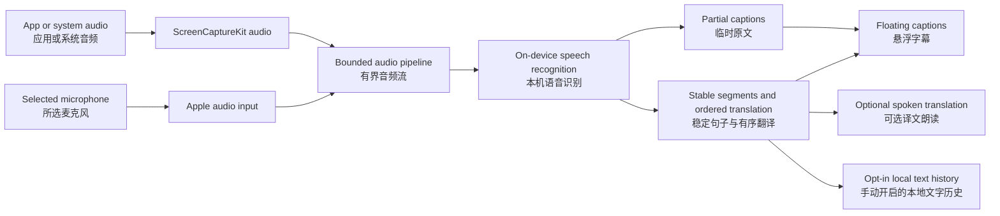

# Architecture · 技术架构



| Area | Source | Responsibility |
| --- | --- | --- |
| Input and permissions | [Audio](../LocalDualCaption/Audio/), [AppModel](../LocalDualCaption/App/AppModel.swift) | Captures only the selected audio source. The ScreenCaptureKit stream registers audio output only. The microphone uses a separate Apple input path. |
| Speech and session lifetime | [Speech](../LocalDualCaption/Speech/), [Pipeline](../LocalDualCaption/Pipeline/) | Converts audio to partial and stable text using local Speech APIs. Bounded queues and session generations prevent a stopped session from updating current captions. |
| Translation and terminology | [Translation](../LocalDualCaption/Translation/) | Preserves stable segment order, applies terminology rules, and uses system translation. Contextual enhancement uses the on-device Apple model where supported and falls back to local system translation when necessary. |
| Presentation | [Overlay](../LocalDualCaption/Overlay/), [UI](../LocalDualCaption/UI/) | Displays current bilingual captions, offers settings and permissions, and drives optional system-voice playback. |
| Local text | [History](../LocalDualCaption/History/), [Privacy](privacy.md) | Stores only consented stable text in the app container, applies storage and queue limits, and optionally generates on-device summaries. TXT export requires a user-selected destination. |

## Build boundaries · 构建边界

The Xcode project uses the macOS SDK and has no Swift package resolution step. macOS manages downloadable speech and translation assets. Apple Intelligence availability depends on the Mac and its system configuration. Local settings and optional histories belong to the user's app container. The source tree contains no sample databases or real recordings.

Xcode 工程直接使用 macOS SDK，无需解析 Swift 软件包。语音和翻译资源的下载由 macOS 管理，Apple 智能功能取决于硬件和系统配置。设置与可选历史保存在用户的应用容器中，源码不包含示例数据库或真实录音。

To regenerate the original preview artwork from its source, run this from the repository root with Xcode selected:

```sh
swift Scripts/render_preview_background.swift LocalDualCaption/Assets.xcassets/OverlayPreviewLandscape.imageset/OverlayPreviewLandscape.png
```
